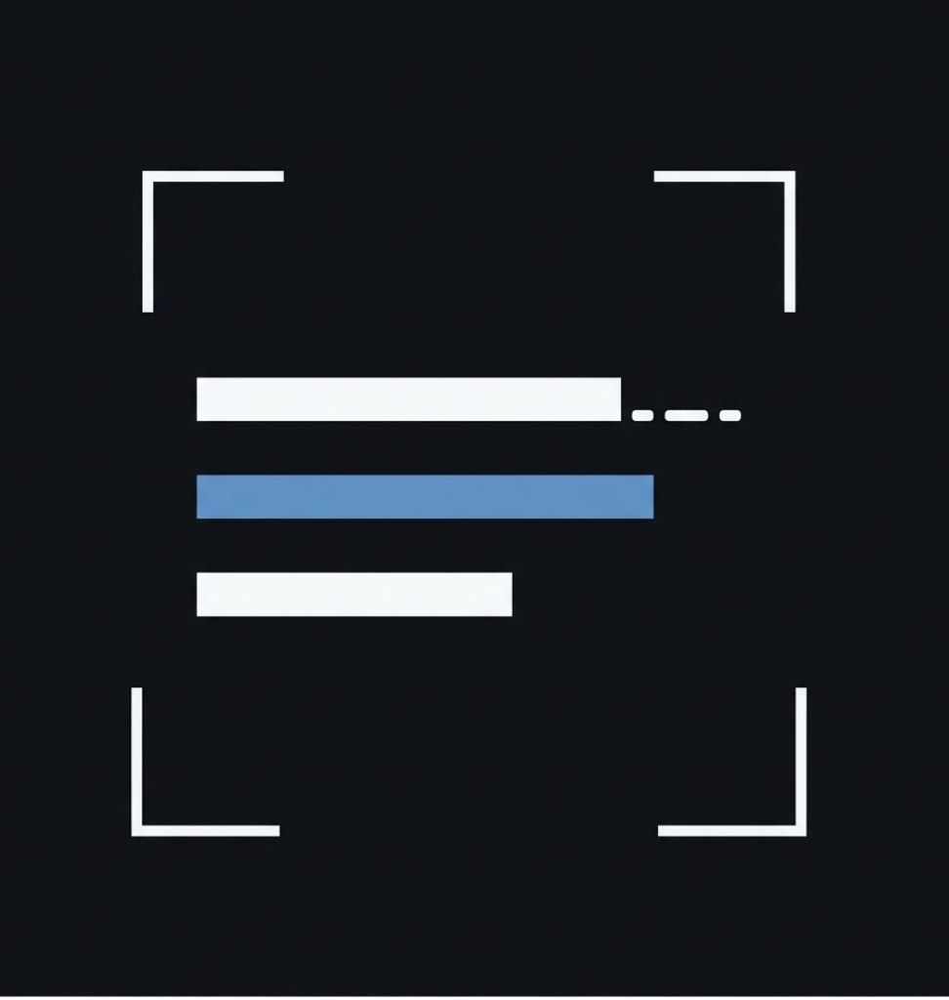

<div align="center">



# SysHUD

**A lightweight, RTSS-style real-time hardware monitoring overlay for Android 8.0+**

[](https://developer.android.com)
[](https://kotlinlang.org)
[](https://m3.material.io)
[](https://shizuku.rikka.app)
[](https://github.com/Snowsniw371/SysHUD/releases)

[Features](#-features) •
[Installation](#-installation) •
[Permissions](#-permissions) •
[Roadmap](#-roadmap)

</div>

---

## Overview

**SysHUD** is a minimal, zero-bloat on-screen display (OSD) built for mobile gaming. Inspired by **RivaTuner Statistics Server (RTSS)** on PC, it pins essential system telemetry directly into the corner of your screen with negligible CPU and RAM overhead—no ads, no analytics, and no root required.

## ✨ Features

- **Real-Time Telemetry:**
  - **CPU:** Peak active core frequency in `MHz`.
  - **RAM:** Used and total system memory in `GB`.
  - **Power & Thermals:** Live battery temperature (`°C`) and discharge wattage (`W`).
  - **Network:** Real-time download (`↓`) and upload (`↑`) traffic speeds in `KB/s` or `MB/s`.
- **Optional FPS Counter:** Frame rate readout powered by **Shizuku** without root access.
- **Pass-Through Touch Lock:** Drag the HUD to any corner, then lock it from the app or directly via the notification shade so touches pass straight through to your game.
- **Clean Customization:**
  - Tabular numbers (`tnum`) to prevent layout jitter when values update.
  - Adjustable font size (`10–18 sp`) and background opacity (`20–100%`).
  - Three color presets: **White**, **RTSS Amber**, and **Ice Blue**.
  - Persistent screen coordinates across restarts.

## 📲 Installation

1. Download the latest `SysHUD-v1.0.0.apk` from the [**Releases**](https://github.com/Snowsniw371/SysHUD/releases) page.
2. Install the APK and open **SysHUD**.
3. Tap **Grant Permission** and enable **Display over other apps** for SysHUD.
4. *(Optional)* Start the **Shizuku** service if you want to enable the **FPS** toggle.
5. Tap **Start Overlay**, drag the HUD to your preferred corner, and tap **Lock** in the notification shade.

> **Note for Xiaomi (HyperOS / MIUI), Samsung, and Realme users:**  
> To prevent the system from killing the overlay during heavy 3D games, set **Battery saver** to **No restrictions** for SysHUD in App Info and lock the app in the Recent Apps menu.

## 🔐 Permissions

SysHUD requests only the permissions strictly required for system monitoring:

| Permission | Purpose |
| :--- | :--- |
| `SYSTEM_ALERT_WINDOW` | Draws the floating telemetry card over games and other apps. |
| `FOREGROUND_SERVICE_SPECIAL_USE` | Keeps the overlay alive in the background without being terminated by Android. |
| `POST_NOTIFICATIONS` | Displays the persistent quick-control notification (`Lock` / `Stop`). |
| `moe.shizuku.privileged.api` *(Optional)* | Queries `SurfaceFlinger` frame timestamps for the FPS counter without root. |

## ⚠️ Known Limitations

- **FPS on Android 15 / 16+:** The current FPS collector uses `dumpsys SurfaceFlinger --latency`, which works reliably on **Android 14 and below**. On Android 15+ (including HyperOS 3 and One UI 7+), Google deprecated legacy frame latency tracking, so the FPS metric may display `N/A` or `--`.
- **CPU Frequency Readout:** Some OEM kernels block non-root read access to `/sys/devices/system/cpu/cpu*/cpufreq/scaling_cur_freq` via SELinux policies.

## 🗺️ Roadmap

- [ ] **Android 15 / 16+ FPS Support:** Migrate the Shizuku FPS collector to `SurfaceFlinger --frametimeline` / `totalFrames` delta tracking with an automatic fallback to `dumpsys gfxinfo`.
- [ ] **Compact Horizontal Mode:** Single-line top bar layout (similar to MangoHud / Steam Deck) for minimal screen footprint.
- [ ] **GPU Telemetry:** Add GPU clock speed and load readout for supported Snapdragon (Adreno) and MediaTek (Mali) sysfs nodes.
- [ ] **Per-App Auto-Launch:** Automatically toggle the HUD when selected games are in the foreground.

## 🛠️ Building from Source

```bash
git clone [https://github.com/Snowsniw371/SysHUD.git](https://github.com/Snowsniw371/SysHUD.git)
cd SysHUD
./gradlew assembleRelease

